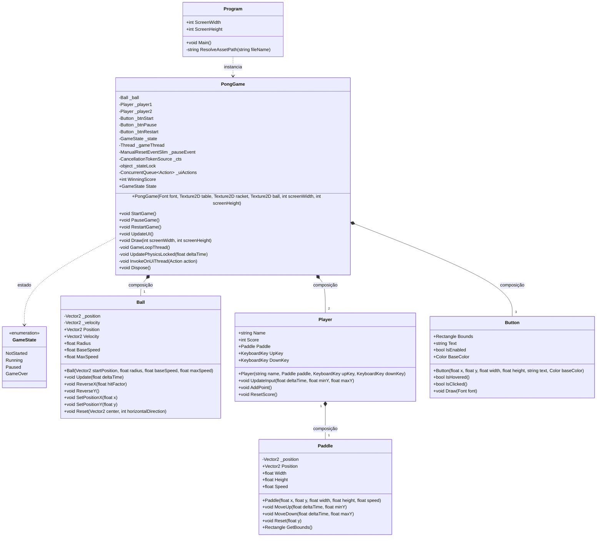

# 🏓 Pong — Programação Orientada a Objetos & Threads

Trabalho prático da disciplina de **Programação Orientada a Objetos (POO)** — **Universidade Federal de São Paulo (Unifesp)**.

O projeto implementa o clássico jogo **Pong** (com temática de tênis de mesa) em **C# (.NET 10)** utilizando a biblioteca gráfica **Raylib-cs** e **programação concorrente com Threads**, separando o processamento contínuo da física e regras de jogo do fluxo principal da interface gráfica.

---

## 📌 1. Visão Geral do Projeto

- **Linguagem & Plataforma**: C# (.NET 10)
- **Biblioteca Gráfica**: [Raylib-cs](https://github.com/ChrisDill/Raylib-cs) (v8.1.0)
- **Resolução de Tela**: Janela HD (1280 x 720 pixels) a 60 FPS com anti-aliasing (MSAA 4x) e VSync.
- **Processamento Concorrente**: Thread dedicada (`PongPhysicsThread`) rodando a ~120 Hz sincronizada via `ManualResetEventSlim`, `lock`, `CancellationTokenSource` e fila thread-safe `ConcurrentQueue<Action>`.
- **Assets Gráficos e Tipografia**:
  - Mesa de tênis de mesa (`table_tennis.png` / `.svg`) centralizada com espaçamento lateral externo para movimentação das raquetes.
  - Raquetes (`racket.png` / `.svg`) com borracha vermelha voltada para a mesa e bola pixel-art (`ball.png` / `.svg`) renderizadas com filtro `Point`.
  - Fonte vetorial suavizada (`font.otf`) com filtro bilinear e suporte a acentuação em português (Latin-1).

---

## 🕹️ 2. Regras e Controles

- **Jogador 1 (Esquerda)**: teclas `W` (cima) e `S` (baixo).
- **Jogador 2 (Direita)**: teclas `Seta para Cima (↑)` e `Seta para Baixo (↓)`.
- **Controles de Partida**:
  - **Iniciar Jogo / Retomar Jogo** (ou tecla `ESPAÇO`): inicia ou retoma a partida.
  - **Pausar Jogo** (ou tecla `ESPAÇO`): suspende temporariamente a movimentação sem zerar o placar.
  - **Reiniciar Jogo** (ou tecla `R`): zera a pontuação e reposiciona a bola e as raquetes.
- **Física e Pontuação**:
  - A bola se movimenta continuamente pela mesa, rebatendo nas bordas superior/inferior e nas raquetes.
  - A cada rebatida nas raquetes durante um ponto, o ângulo varia conforme o ponto de impacto e a velocidade aumenta sutilmente (+5%, de `440 px/s` até `820 px/s`).
  - Ao ultrapassar a raquete adversária, o jogador marca **1 ponto** e a bola retorna ao centro com nova direção inicial.
  - Vence quem atingir **5 pontos** primeiro (`WinningScore = 5`).

---

## 💻 3. Arquitetura POO e Threads

O projeto foi dividido em classes de domínio bem delimitadas, aplicando encapsulamento, construtores, composição/associação e programação concorrente com Threads:



### Detalhamento das Classes

1. **`Ball` (`src/Models/Ball.cs`)**: Encapsula `_position` e `_velocity` privados, movimentação contínua (`Update`), rebatida vertical (`ReverseY`), rebatida horizontal com ângulo dinâmico e ganho sutil de +5% de velocidade por rebatida (`ReverseX`), e retorno ao centro após ponto (`Reset`).
2. **`Paddle` (`src/Models/Paddle.cs`)**: Encapsula posição, dimensões e velocidade da raquete, restringindo o movimento vertical aos limites da mesa (`MoveUp`, `MoveDown`) e expondo o retângulo de colisão (`GetBounds`).
3. **`Player` (`src/Models/Player.cs`)**: Encapsula a pontuação (`Score` com `private set`), associa/compõe sua respectiva `Paddle` e processa as teclas do jogador (`W`/`S` ou `↑`/`↓`).
4. **`Button` (`src/UI/Button.cs`)**: Componente reutilizável da interface gráfica com detecção de hover/clique (`IsHovered`, `IsClicked`), estado habilitado (`IsEnabled`) e renderização (`Draw`).
5. **`PongGame` (`src/Game/PongGame.cs`)**: Orquestra a partida, colisões, placar até 5 pontos, renderização e o ciclo de vida da thread dedicada de física (`IDisposable`).
6. **`Program` (`Program.cs`)**: Inicializa a janela Raylib-cs (`1280x720`, MSAA 4x, VSync), carrega fonte/texturas e garante o encerramento seguro via bloco `using`.

### Estrutura de Diretórios

```text
pong/
├── Pong.csproj                 # Projeto .NET 10 com Raylib-cs e cópia automática de assets/
├── Program.cs                  # Ponto de entrada, janela principal (UI Thread) e Dispose seguro
├── relatorio.tex               # Relatório técnico em LaTeX (com diagrama UML em TikZ)
├── relatorio.pdf               # Relatório compilado em PDF
├── prints/                     # Capturas de tela usadas no relatório
├── assets/                     # Fonte vetorial (.otf), SVGs originais e PNGs renderizados
└── src/
    ├── Models/
    │   ├── Ball.cs             # Posição, velocidade, movimentação, rebatidas e aceleração sutil
    │   ├── Paddle.cs           # Posição, dimensões, velocidade e movimento vertical limitado
    │   └── Player.cs           # Nome, pontuação, teclas de controle e composição com Paddle
    ├── UI/
    │   └── Button.cs           # Componente interativo ("Iniciar", "Pausar", "Reiniciar")
    └── Game/
        └── PongGame.cs         # Regras, colisões, renderização e Thread dedicada de física
```

### Principais Mecanismos de Concorrência (`src/Game/PongGame.cs`)
- **`Thread _gameThread`**: processa movimentação, colisões e pontuação continuamente sem travar a UI.
- **`ManualResetEventSlim _pauseEvent`**: suspende a thread de física quando pausada/aguardando início (sem *busy-wait*) e retoma instantaneamente ao iniciar.
- **`lock (_stateLock)`**: garante exclusão mútua entre a atualização física e a leitura de snapshot para renderização em `Draw()`.
- **`ConcurrentQueue<Action> _uiActions` (`InvokeOnUiThread`)**: equivalente ao `BeginInvoke` no modelo de loop do Raylib-cs para despachar atualizações de estado/interface à thread principal.
- **`CancellationTokenSource` + `Thread.Join()` em `Dispose()`**: garante encerramento limpo da thread ao fechar a janela.

---

## ▶️ 4. Como Compilar e Executar

### Pré-requisitos
- [.NET 10 SDK](https://dotnet.microsoft.com/download) instalado.
- Ambiente gráfico com suporte à biblioteca **Raylib** (Windows, Linux ou macOS).

### Passos
```bash
cd pong
dotnet build
dotnet run
```
